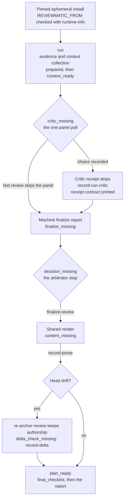
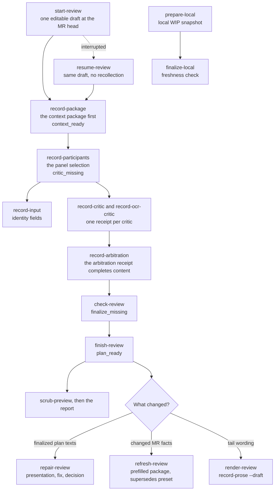
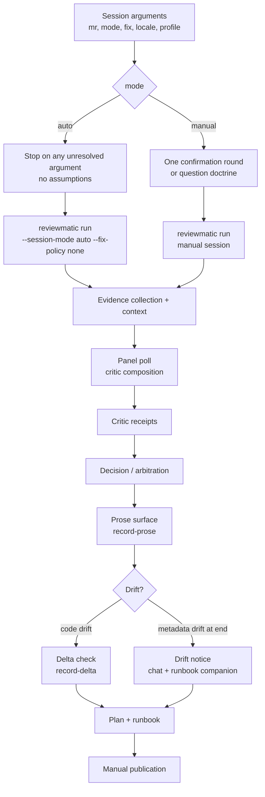
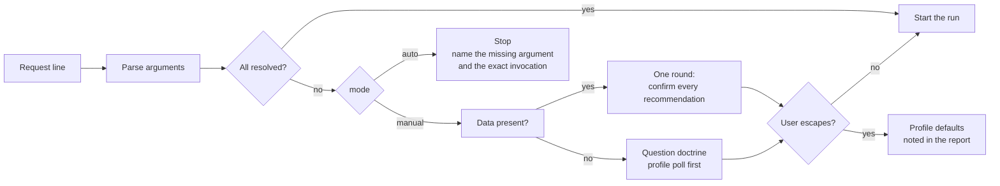
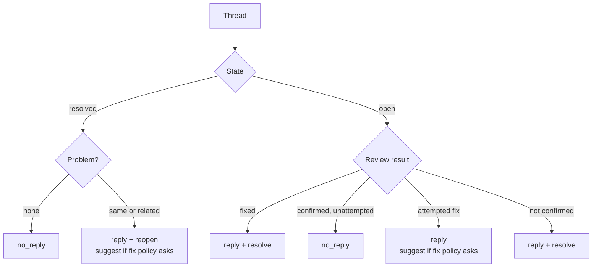

# Code-Review Waves, Modes, and the Thread Matrix

[Русский](../ru/reference/code-review.md)

This reference documents the `code-review` session mechanics introduced by
decisions 72 and 75: the review wave diagram, the `auto`/`manual` session
modes with their argument resolution, the six-case thread matrix, the
Conventional Comments enforcement, and the inverted tail with its drift
behavior. The skill texts in `skills/code-review/` own the operational
doctrine; this page is the architecture view.

## Pipeline map

One map for the review line: the one-process run path, the explicitly marked
draft and repair path, the local WIP mode, and the emergency exits. Nodes,
stages, and commands name the runtime's canonical tokens; the contract test
in apps/reviewmatic/tests/test\_skill\_contract.py pins both directions, so a
renamed stage or a new command cannot appear on one side alone. Every
authoring stop prints its template, its complete field contract, and the
exact continuation command; the operational doctrine stays in
`skills/code-review/`.

**Diagram 1. The run path: one `reviewmatic run` from collection to `plan_ready`.**

**Diagram 2. The marked draft and repair path, with the local WIP lane.**

Each row of the stage table is one authoring stop: what the agent writes
there, which command applies it, and which contract the stop prints.

| Stage | Path | The agent authors | Continue with | Printed at the stop |
| - | - | - | - | - |
| `prepared` | run and draft | nothing yet: collection is machine work, the draft opens one editable draft | `reviewmatic run` continues by itself; `reviewmatic start-review` opens the draft | the draft schema and input contract |
| `context_ready` | draft | the context package: goal, claims, constraints, questions, thread registry | `reviewmatic record-package` | the package contract with the assigned questions |
| `critic_missing` | run and draft | the poll choice, then one receipt per critic, verbatim | run: `reviewmatic run --resume --participants <template>`; draft: `reviewmatic record-participants`, `reviewmatic record-input`, `reviewmatic record-critic`, `reviewmatic record-ocr-critic` | `poll_block` with the selection template; the receipt contract at every critic stop |
| `finalize_missing` | run and draft | nothing: the machine draws the finalize report, the draft validates locally | resume; `reviewmatic check-review`, `reviewmatic finish-review` | the finalize summary; the validation report |
| `decision_missing` | run | the arbitrator decision: responses, CI assessments, verdict | `reviewmatic finalize-review` | the prefilled template, the vocabularies, and the blocking rule |
| `content_missing` | run and draft tail | the prose file: publications, thread decisions, labels, SemVer | run: `reviewmatic record-prose`; separate draft: `reviewmatic render-review` first | the prose projection with the authoring vocabularies |
| `delta_check_missing` | drift | a fresh delta verification of the affected conclusions | `reviewmatic record-delta` | the delta template and the verifier rules |
| `plan_ready` | run and draft | the final chat summary alone | nothing more: publication stays manual | `final_checklist`; the runbook |
| `stale` | refresh | updated entries for stale threads and changed evidence | `reviewmatic refresh-review` | the changed fingerprints and the prefilled package |

Every exit from the normal sequence takes the cheapest path that honestly
covers the change.

| Trigger | Cheapest honest path | Command |
| - | - | - |
| A recorded artifact is wrong or out of order before the final plan | correct the artifact; the runtime rewinds the derived stages and prints the continuation | `reviewmatic replace-artifact` |
| The receipt is uncertain before an import | a write-free probe: the stage and every digest stay identical | `reviewmatic record-artifact --validate-only` |
| Head drift after collection | re-anchor the machine fields, then one fresh delta check | `reviewmatic re-anchor-review`, `reviewmatic record-delta` |
| Changed MR facts | refresh the draft and keep the selection | `reviewmatic refresh-review` |
| Finalized plan: wording, fix representation, or decision | targeted repair by cost | `reviewmatic repair-review` with `--kind presentation`, `--kind fix`, or `--kind decision` |
| The session was lost or interrupted | the same draft and panel, no recollection | `reviewmatic resume-review` |
| A scope question appears mid-review | re-print the scope overview | `reviewmatic scope-review` |
| A local WIP review | the local mode: the same stages without the MR | `reviewmatic prepare-local`, `reviewmatic finalize-local` |
| Session profiles | explicit XDG profiles, written once | `reviewmatic profile-setup`, `reviewmatic profile-show` |
| Raw SHA exposure before reporting | preview every exposure | `reviewmatic scrub-preview` |
| An unfamiliar runtime identity | verify the pinned install | `reviewmatic runtime-info` |

## The review wave

One remote review passes through collection, panel, arbitration, prose, and
publication stages. Every authoring stop prints its own template and the exact
continuation command; drift never discards authorship silently.

## Session modes and argument resolution

Five arguments resolve from the request line: `mr=`, `mode=auto|manual`,
`fix=none|suggestion|patch`, `locale=en|ru`, `profile=<name>`. The free text
after the arguments is context. `auto` stops on any unresolved argument and
forces `fix=none`; `manual` confirms its recommendations in one round, asks
dependency-bounded questions when nothing is provided, and honors the
"continue without questions" escape by finishing on profile defaults with a
report note. Profiles live under
`${XDG_CONFIG_HOME:-~/.config}/agent-skills/code-review/profiles/` and are
written only by `reviewmatic profile-setup` (the `profile=setup` flow).

## The six-case thread matrix

`no_reply` replaced `no_publication` across the contract, the canon, the
materialized runtime, the tests, and the documentation. An open thread with a
confirmed but unattempted defect now takes `no_reply` instead of being forced
into a reply.

| # | Thread state | Review result | Outcome |
| - | - | - | - |
| 1 | resolved | no problem | `no_reply` |
| 2 | resolved | same or related problem | `reply` + `reopen` (+ suggestion when the fix policy asks) |
| 3 | open | fixed | `reply` + `resolve` |
| 4 | open | confirmed, no fix attempted | `no_reply` |
| 5 | open | not fixed, fix attempted | `reply` (+ suggestion when the fix policy asks) |
| 6 | open | not confirmed | `reply` + `resolve` |

Every published answer opens with a Conventional Comments label
(`suggestion`, `issue`, `question`, `note`, `praise`, or `todo`, optionally
preceded by `blocking:`); the runtime refuses an unlabeled published answer
and the label renders in the runbook beside the body preview.

## The auto runbook

In the auto session the runbook carries ready comment bodies only: findings as
comments without suggestions or Git patches, plus one metadata proposal
comment holding the SemVer contribution, the label add/remove delta, and the
title, description, and milestone recommendations. No per-item shell commands
are generated; publication stays manual, and `publish=auto` is out of scope.

## The inverted tail and drift

Once the decision is recorded, the runtime renders the complete content,
machine fields derived by the validators' own functions, prose fields as
placeholders. The agent edits one prose file applied by one command. Head
drift re-anchors machine fields and asks for a fresh delta check; metadata
drift discovered at finalization produces a notice in the chat and a runbook
companion (`drift-notice.md`) with an incremental-restart recommendation
instead of dropping the authoring chain.
