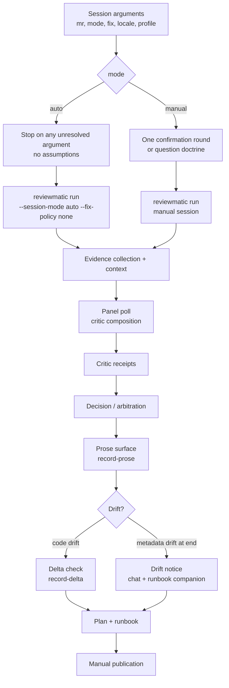
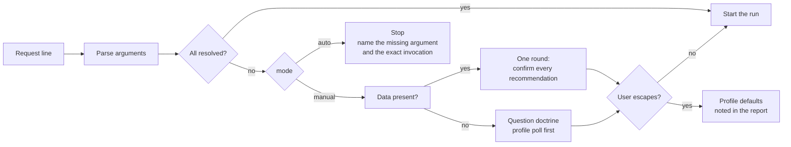
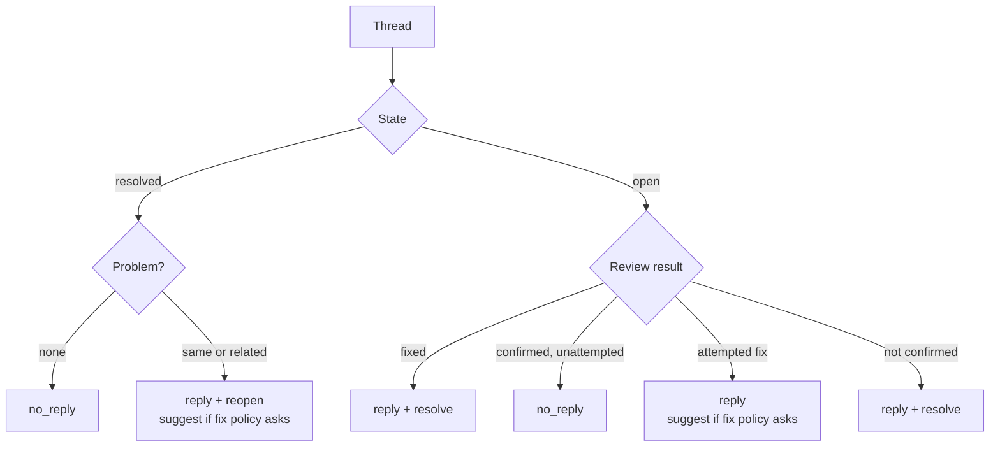

# Code-Review Waves, Modes, and the Thread Matrix

[Русский](../ru/reference/code-review.md)

This reference documents the `code-review` session mechanics introduced by
decisions 72 and 75: the review wave diagram, the `auto`/`manual` session
modes with their argument resolution, the six-case thread matrix, the
Conventional Comments enforcement, and the inverted tail with its drift
behavior. The skill texts in `skills/code-review/` own the operational
doctrine; this page is the architecture view.

## The review wave

One remote review passes through collection, panel, arbitration, prose, and
publication stages. Every authoring stop prints its own template and the exact
continuation command; drift never discards authorship silently.

## Session modes and argument resolution

Five arguments resolve from the request line: `mr=`, `mode=auto|manual`,
`fix=none|suggestion|patch`, `locale=en|ru`, `profile=<name>`. The free text
after the arguments is context. `auto` stops on any unresolved argument and
forces `fix=none`; `manual` confirms its recommendations in one round, asks
dependency-bounded questions when nothing is provided, and honors the
"continue without questions" escape by finishing on profile defaults with a
report note. Profiles live under
`${XDG_CONFIG_HOME:-~/.config}/agent-skills/code-review/profiles/` and are
written only by `reviewmatic profile-setup` (the `profile=setup` flow).

## The six-case thread matrix

`no_reply` replaced `no_publication` across the contract, the canon, the
materialized runtime, the tests, and the documentation. An open thread with a
confirmed but unattempted defect now takes `no_reply` instead of being forced
into a reply.

| # | Thread state | Review result | Outcome |
| - | - | - | - |
| 1 | resolved | no problem | `no_reply` |
| 2 | resolved | same or related problem | `reply` + `reopen` (+ suggestion when the fix policy asks) |
| 3 | open | fixed | `reply` + `resolve` |
| 4 | open | confirmed, no fix attempted | `no_reply` |
| 5 | open | not fixed, fix attempted | `reply` (+ suggestion when the fix policy asks) |
| 6 | open | not confirmed | `reply` + `resolve` |

Every published answer opens with a Conventional Comments label
(`suggestion`, `issue`, `question`, `note`, `praise`, or `todo`, optionally
preceded by `blocking:`); the runtime refuses an unlabeled published answer
and the label renders in the runbook beside the body preview.

## The auto runbook

In the auto session the runbook carries ready comment bodies only: findings as
comments without suggestions or Git patches, plus one metadata proposal
comment holding the SemVer contribution, the label add/remove delta, and the
title, description, and milestone recommendations. No per-item shell commands
are generated; publication stays manual, and `publish=auto` is out of scope.

## The inverted tail and drift

Once the decision is recorded, the runtime renders the complete content,
machine fields derived by the validators' own functions, prose fields as
placeholders. The agent edits one prose file applied by one command. Head
drift re-anchors machine fields and asks for a fresh delta check; metadata
drift discovered at finalization produces a notice in the chat and a runbook
companion (`drift-notice.md`) with an incremental-restart recommendation
instead of dropping the authoring chain.
