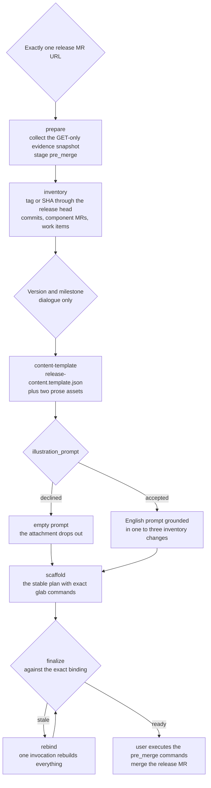
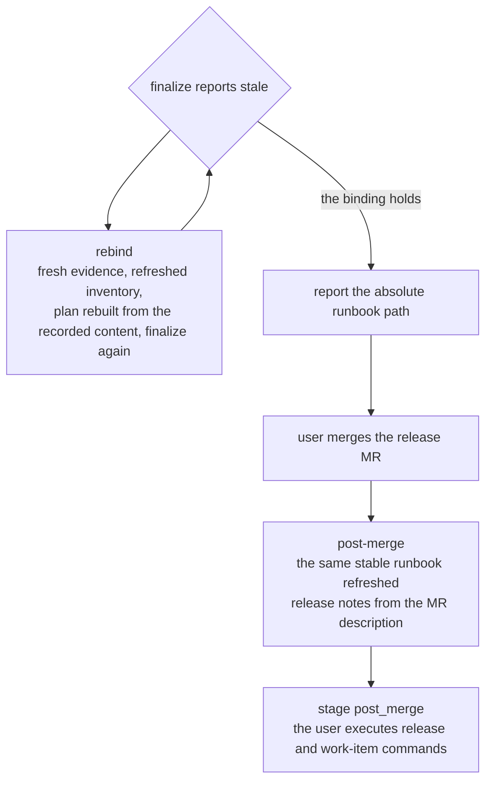

# Release preparation chain map

[Русский](../ru/reference/release-prepare.md)

This reference maps the `release-prepare` chain: from one release MR to the
stable runbook and the post-merge refresh. The skill texts in
`skills/release-prepare/` own the operational doctrine; this page is the
navigation view. Every helper surface prints its complete contract — field
dictionaries, accepted values, and the next commands — in its own answer, and
the printed answer is the only format source. Helpers stay read-only for
GitLab: they collect evidence and write local artifacts, but they never
execute a publication command; the user runs every command manually.

## Release chain map

One chain binds everything: evidence, inventory, content, plan,
finalization, and the post-merge refresh. A stale plan never sends the chain
back to the start by hand.

**Diagram 1. The chain from the accepted release MR to the post-merge runbook.**

Each step below names the command, the machine part, and what the agent
authors before the next step can run.

| Step | Command | Machine part | The agent authors |
| - | - | - | - |
| Collect evidence | `prepare_release.py prepare --url <release-mr-url>` | one accepted URL becomes an evidence snapshot | confirm the exact release MR and the checkout |
| Build the inventory | `prepare_release.py inventory --evidence <evidence> --repo-root <checkout>` | complete pagination of commits, component MRs, approvals, and work items; an explicit `--previous-ref <tag-or-sha>` boundary | verify every item; keep the exact boundary |
| Decide version and milestone | dialogue | no helper command | the SemVer rationale from observable changes; the milestone selection |
| Materialize content | `prepare_release.py content-template --bundle <evidence> --inventory <inventory>` | `release-content.template.json` with machine prefills and two prose asset files | fill the semantic fields; author the two prose assets |
| Scaffold the plan | `prepare_release.py scaffold --bundle <evidence> --inventory <inventory> --content <content>` | `release-publication.json` with the staged `pre_merge` commands | review the printed runbook; hand the commands to the user |
| Finalize | `prepare_release.py finalize --plan <plan> --expected-binding <binding>` | freshness against the exact binding | report only the absolute stable runbook path |
| Rebind when stale | `prepare_release.py rebind --plan <pointer>` | fresh evidence, refreshed inventory, rebuilt plan, finalize in one invocation | review the printed changed fingerprints with the user |
| Post-merge refresh | `prepare_release.py post-merge --plan <plan> --expected-binding <binding> --content <ledger>` | the same runbook re-staged to `post_merge` | confirm the merged MR; the user executes the release commands |

## Prose assets, humanize, and the illustration

The description and the announcement are prose assets: the runtime
materializes `release-description.md` and `release-announcement.md`, and the
content references them through `description_file` and `announcement_file` —
never inline long prose into the JSON content. The title, the description,
and the announcement are written in the language of the latest user request,
then go through the required `humanize` pass; the changelog register bounds
every item to user-visible behavior.

The illustration is optional. When the user declines it, `illustration_prompt`
stays an empty string: the runtime records the declined note, drops the
attachment from the announcement command, and marks the runbook section
declined — an invented artwork prompt never satisfies a non-empty field. When
the user accepts, the prompt is English, 16:9, and grounded in one to three
concrete inventory changes.

## Staleness, rebind, and the post-merge refresh

Finalization revalidates the exact binding: changed base, start, or head SHA,
MR or merge state, milestone, inventory, approvals, item decisions, or
payload makes the plan stale. A stale finalize answer prints the exact
one-step rebind command; re-walking the chain by hand is never the answer.

**Diagram 2. The staleness loop and the post-merge refresh of the same runbook.**

The post-merge helper verifies the exact merged MR and commit, rejects an
existing release or a same-name tag elsewhere, copies the MR description as
the GitLab Release notes byte for byte, and adds one exact manual `glab`
release command plus one command per approved work-item action. An inventory
change passes the approved content ledger with `--content`; `no action`
entries and their rationales stay visible.

## The publication boundary

Every helper and this skill stay read-only for GitLab. The user runs each
prepared command at most once, inspects the response — the GraphQL API
answers HTTP 200 even on failure — and never treats a displayed command or a
local file as execution proof. Regenerated command blocks carry explicit
execution-status markers, and a run-unverified action stays visible until
refreshed GitLab evidence confirms its target state.
