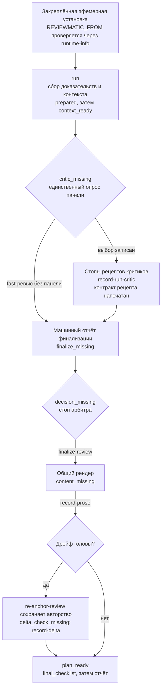
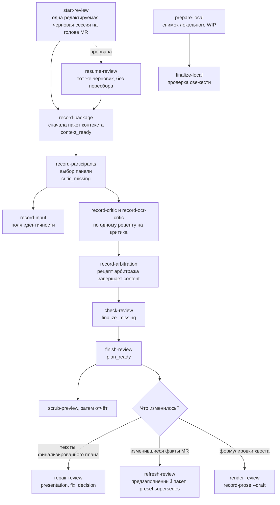
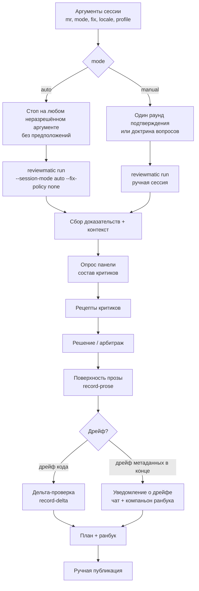
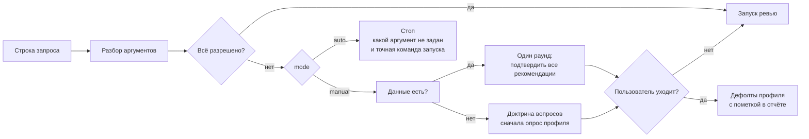
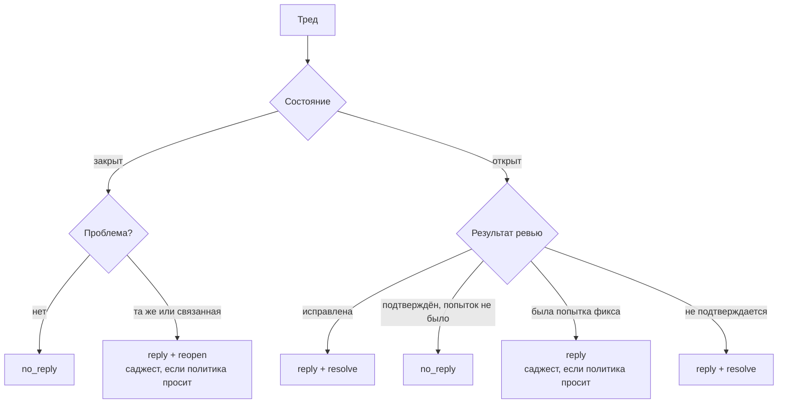

# Волны ревью, режимы и матрица тредов

[English](../../reference/code-review.md)

Эта страница документирует механику сессий `code-review` из решений 72 и 75:
волновую диаграмму ревью, режимы `auto`/`manual` с разрешением аргументов,
матрицу тредов из шести случаев, обязательность Conventional Comments и
инвертированный хвост с его поведением при дрейфе. Операционную доктрину
владеют тексты скилла в `skills/code-review/`; здесь — архитектурный вид.

## Карта конвейера

Одна карта на линию ревью: однопроцессный run-путь, явно отмеченные draft- и
repair-пути, режим локального WIP и аварийные выходы. Узлы, стадии и команды
называют канонические токены рантайма; контрактный тест в
apps/reviewmatic/tests/test\_skill\_contract.py пинит оба направления, так
что переименованная стадия или новая команда не могут появиться на одной
стороне в одиночку. Каждый авторинг-стоп печатает свой шаблон, полный
контракт полей и точную команду продолжения; операционная доктрина остаётся
в `skills/code-review/`.

**Диаграмма 1. Run-путь: один `reviewmatic run` от сборки до `plan_ready`.**

**Диаграмма 2. Отмеченные draft- и repair-пути и lane локального WIP.**

Каждая строка таблицы стадий — один авторинг-стоп: что там пишет агент,
какой командой это применяется и какой контракт печатает стоп.

| Стадия | Путь | Пишет агент | Продолжение командой | Печатается на стопе |
| - | - | - | - | - |
| `prepared` | run и draft | пока ничего: сбор — машинная работа, draft открывает одну редактируемую черновую сессию | `reviewmatic run` продолжает сам; `reviewmatic start-review` открывает черновик | схема черновика и input-контракт |
| `context_ready` | draft | пакет контекста: цель, утверждения, ограничения, вопросы, реестр тредов | `reviewmatic record-package` | контракт пакета с назначенными вопросами |
| `critic_missing` | run и draft | выбор в опросе, затем по одному рецепту на критика, дословно | run: `reviewmatic run --resume --participants <template>`; draft: `reviewmatic record-participants`, `reviewmatic record-input`, `reviewmatic record-critic`, `reviewmatic record-ocr-critic` | `poll_block` с шаблоном выбора; контракт рецепта на каждом стопе критика |
| `finalize_missing` | run и draft | ничего: машина рисует отчёт финализации, draft валидируется локально | resume; `reviewmatic check-review`, `reviewmatic finish-review` | итог финализации; отчёт валидации |
| `decision_missing` | run | решение арбитра: responses, оценки CI, вердикт | `reviewmatic finalize-review` | предзаполненный шаблон, словари и правило блокировки |
| `content_missing` | run и хвост draft | файл прозы: публикации, решения тредов, метки, SemVer | run: `reviewmatic record-prose`; отдельный draft: сначала `reviewmatic render-review` | прозовая проекция со словарями авторинга |
| `delta_check_missing` | дрейф | свежая дельта-проверка затронутых выводов | `reviewmatic record-delta` | дельта-шаблон и правила верификатора |
| `plan_ready` | run и draft | только итоговое резюме в чат | больше ничего: публикация остаётся ручной | `final_checklist`; ранбук |
| `stale` | refresh | обновлённые записи для устаревших тредов и изменившихся доказательств | `reviewmatic refresh-review` | изменившиеся отпечатки и предзаполненный пакет |

Каждый выход из нормальной последовательности берёт самый дешёвый путь,
который честно покрывает изменение.

| Триггер | Самый дешёвый честный путь | Команда |
| - | - | - |
| Записанный артефакт неверен или записан вне порядка до финального плана | исправить артефакт; рантайм отматывает производные стадии и печатает продолжение | `reviewmatic replace-artifact` |
| Рецепт вызывает сомнения до импорта | write-free проба: стадия и все дайджесты остаются неизменными | `reviewmatic record-artifact --validate-only` |
| Дрейф головы после сборки | переанкеровать машинные поля, затем одна свежая дельта-проверка | `reviewmatic re-anchor-review`, `reviewmatic record-delta` |
| Изменились факты MR | освежить черновик, сохранив выбор панели | `reviewmatic refresh-review` |
| Финализированный план: формулировки, представление фикса или решение | точечный ремонт по стоимости | `reviewmatic repair-review` с `--kind presentation`, `--kind fix` или `--kind decision` |
| Сессия потеряна или прервана | тот же черновик и панель, без пересбора | `reviewmatic resume-review` |
| Вопрос о scope возник посреди ревью | снова напечатать обзор scope | `reviewmatic scope-review` |
| Ревью локального WIP | локальный режим: те же стадии без MR | `reviewmatic prepare-local`, `reviewmatic finalize-local` |
| Профили сессии | явные XDG-профили, записываются один раз | `reviewmatic profile-setup`, `reviewmatic profile-show` |
| Утечка raw SHA до отчёта | предпросмотр каждой утечки | `reviewmatic scrub-preview` |
| Незнакомая идентичность рантайма | проверить закреплённую установку | `reviewmatic runtime-info` |

## Волна ревью

Одно удалённое ревью проходит сбор доказательств, панель, арбитраж,
авторинг прозы и публикацию. Каждый авторинг-стоп печатает свой шаблон и
точную команду продолжения; дрейф никогда не отбрасывает авторинг молча.

## Режимы сессии и разрешение аргументов

Пять аргументов разбираются из строки запроса: `mr=`, `mode=auto|manual`,
`fix=none|suggestion|patch`, `locale=en|ru`, `profile=<name>`. Свободный
остаток строки — контекст. `auto` останавливается на любом неразрешённом
аргументе и принудительно требует `fix=none`; `manual` подтверждает свои
рекомендации одним раундом, а без данных спрашивает по доктрине вопросов;
escape «дальше без вопросов» завершает оставшееся на дефолтах профиля с
пометкой в отчёте. Профили лежат в
`${XDG_CONFIG_HOME:-~/.config}/agent-skills/code-review/profiles/` и
записываются только командой `reviewmatic profile-setup` (механизм
`profile=setup`).

## Матрица тредов из шести случаев

`no_reply` заменил `no_publication` везде: контракт, канон, материализованный
рантайм, тесты и документация. Открытый тред с подтверждённым, но не
чинившимся дефектом теперь берёт `no_reply` вместо принудительного ответа.

| № | Состояние треда | Результат ревью | Исход |
| - | - | - | - |
| 1 | закрыт | проблемы нет | `no_reply` |
| 2 | закрыт | та же или связанная проблема | `reply` + `reopen` (+ саджест, если fix-политика просит) |
| 3 | открыт | исправлена | `reply` + `resolve` |
| 4 | открыт | подтверждён, фикса не было | `no_reply` |
| 5 | открыт | не исправлена, была попытка | `reply` (+ саджест, если fix-политика просит) |
| 6 | открыт | не подтверждается | `reply` + `resolve` |

Каждый публикуемый ответ открывается меткой Conventional Comments
(`suggestion`, `issue`, `question`, `note`, `praise` или `todo`, опционально с
префиксом `blocking:`); рантайм отвергает ответ без метки, а метка
рендерится в ранбук рядом с превью тела.

## Ранбук авто-режима

В авто-режиме ранбук несёт только готовые тела комментариев: находки как
комментарии без саджестов и git-патчей плюс один комментарий-предложение с
вкладом SemVer, дельтой меток и рекомендациями по заголовку, описанию и
майлстоуну. Команды-под-исполнение не формируются; публикация остаётся
ручной, `publish=auto` вне объёма волны.

## Инвертированный хвост и дрейф

После записи решения рантайм рендерит полный контент: машинные поля —
функциями самих валидаторов, прозаические — плейсхолдерами. Агент правит один
файл прозы, применяемый одной командой. Дрейф головы переанкерует машинные
поля и просит свежую дельта-проверку; дрейф метаданных, найденный на
финализации, даёт уведомление в чат и компаньон ранбука
(`drift-notice.md`) с рекомендацией инкрементального перезапуска вместо
падения авторинг-цепочки.
