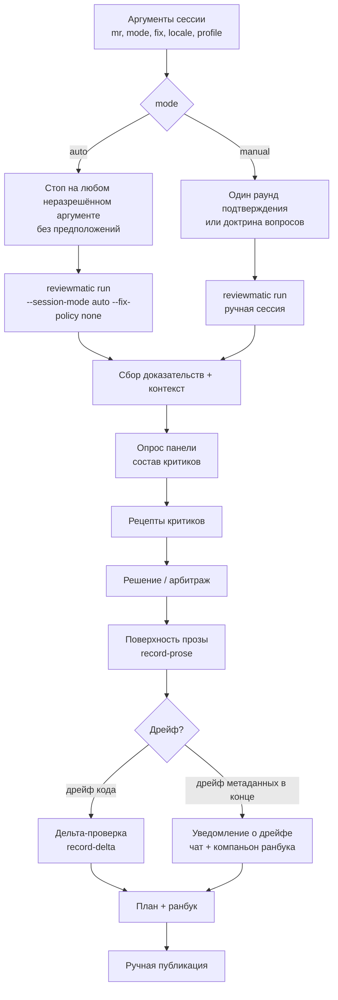
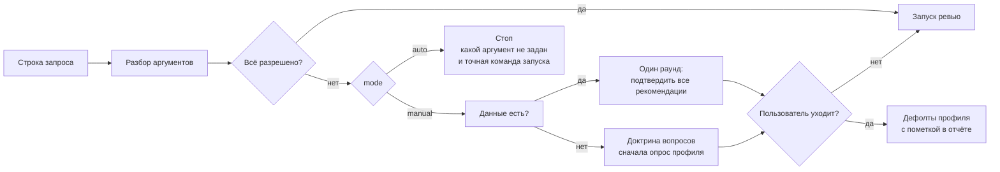
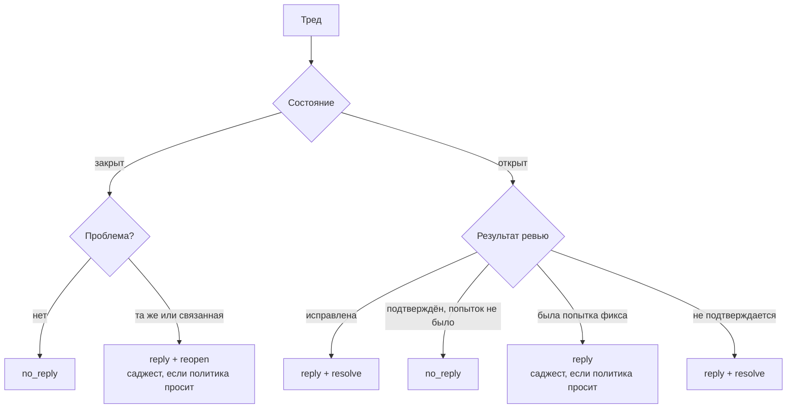

# Волны ревью, режимы и матрица тредов

[English](../../reference/code-review.md)

Эта страница документирует механику сессий `code-review` из решений 72 и 75:
волновую диаграмму ревью, режимы `auto`/`manual` с разрешением аргументов,
матрицу тредов из шести случаев, обязательность Conventional Comments и
инвертированный хвост с его поведением при дрейфе. Операционную доктрину
владеют тексты скилла в `skills/code-review/`; здесь — архитектурный вид.

## Волна ревью

Одно удалённое ревью проходит сбор доказательств, панель, арбитраж,
авторинг прозы и публикацию. Каждый авторинг-стоп печатает свой шаблон и
точную команду продолжения; дрейф никогда не отбрасывает авторинг молча.

## Режимы сессии и разрешение аргументов

Пять аргументов разбираются из строки запроса: `mr=`, `mode=auto|manual`,
`fix=none|suggestion|patch`, `locale=en|ru`, `profile=<name>`. Свободный
остаток строки — контекст. `auto` останавливается на любом неразрешённом
аргументе и принудительно требует `fix=none`; `manual` подтверждает свои
рекомендации одним раундом, а без данных спрашивает по доктрине вопросов;
escape «дальше без вопросов» завершает оставшееся на дефолтах профиля с
пометкой в отчёте. Профили лежат в
`${XDG_CONFIG_HOME:-~/.config}/agent-skills/code-review/profiles/` и
записываются только командой `reviewmatic profile-setup` (механизм
`profile=setup`).

## Матрица тредов из шести случаев

`no_reply` заменил `no_publication` везде: контракт, канон, материализованный
рантайм, тесты и документация. Открытый тред с подтверждённым, но не
чинившимся дефектом теперь берёт `no_reply` вместо принудительного ответа.

| № | Состояние треда | Результат ревью | Исход |
| - | - | - | - |
| 1 | закрыт | проблемы нет | `no_reply` |
| 2 | закрыт | та же или связанная проблема | `reply` + `reopen` (+ саджест, если fix-политика просит) |
| 3 | открыт | исправлена | `reply` + `resolve` |
| 4 | открыт | подтверждён, фикса не было | `no_reply` |
| 5 | открыт | не исправлена, была попытка | `reply` (+ саджест, если fix-политика просит) |
| 6 | открыт | не подтверждается | `reply` + `resolve` |

Каждый публикуемый ответ открывается меткой Conventional Comments
(`suggestion`, `issue`, `question`, `note`, `praise` или `todo`, опционально с
префиксом `blocking:`); рантайм отвергает ответ без метки, а метка
рендерится в ранбук рядом с превью тела.

## Ранбук авто-режима

В авто-режиме ранбук несёт только готовые тела комментариев: находки как
комментарии без саджестов и git-патчей плюс один комментарий-предложение с
вкладом SemVer, дельтой меток и рекомендациями по заголовку, описанию и
майлстоуну. Команды-под-исполнение не формируются; публикация остаётся
ручной, `publish=auto` вне объёма волны.

## Инвертированный хвост и дрейф

После записи решения рантайм рендерит полный контент: машинные поля —
функциями самих валидаторов, прозаические — плейсхолдерами. Агент правит один
файл прозы, применяемый одной командой. Дрейф головы переанкерует машинные
поля и просит свежую дельта-проверку; дрейф метаданных, найденный на
финализации, даёт уведомление в чат и компаньон ранбука
(`drift-notice.md`) с рекомендацией инкрементального перезапуска вместо
падения авторинг-цепочки.
