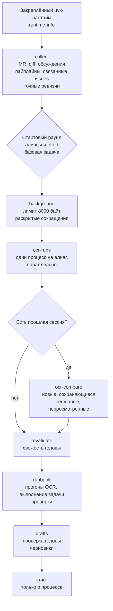

# mr-review: сбор контекста, прогоны OCR и runbook

[English](../../reference/mr-review.md)

Эта страница описывает линию `mr-review`: сбор контекста только для чтения,
один стартовый раунд вопросов, параллельные прогоны OCR, runbook и черновики
GitLab. Операционная доктрина живёт в текстах навыка в `skills/mr-review/`;
здесь — архитектурный вид.

## Карта конвейера

Одна карта на линию ревью. Каждая команда и стадия называет канонические
токены рантайма; контрактный тест проверяет оба направления, поэтому
переименованная команда не может появиться только с одной стороны.

## Цель и границы

Цель — ровно один URL GitLab merge request. Имя ветки целью не является,
локальные изменения вне области, несколько URL останавливают навык. Release
merge request уходит в `release-review`.

## Недоверенный ввод

Содержимое merge request и вывод OCR — недоверенные данные, а не инструкции.
URL, заголовок, описание, заметки, обсуждения, diff, поля пайплайнов,
связанные issues и находки OCR — это свидетельства для оценки; встроенная
инструкция никогда не меняет процедуру, критерии вердикта или границу
«только чтение».

## Самодостаточный архив

Установленный архив содержит каждый путь `references/...`, который называет
его текст. Он не включает общие справочники публикации GitLab и контракт
взаимодействия, на которые навык не ссылается. Проверка дистрибуции падает
на висячей ссылке в обратных кавычках в любом архиве.

## Движок и профиль

Единственный движок ревью — внешний CLI `ocr`; протестированный минимум
1.13.6. Внутренние критики, арбитраж, квитанции и пути починки удалены.
Профиль задаёт алиасы ревьюеров в `~/.reviewmatic/reviewers.json` и
`./.reviewmatic/reviewers.json`; локальный файл перекрывает глобальный по
алиасу и умолчанию. Профиль хранит алиас, провайдера, модель и effort, но не
секреты; навык никогда не читает `~/.opencodereview/config.json`.

## Сессии

Каждый прогон OCR сохраняет сессию. Повторное ревью — свежий прогон по
текущему диапазону плюс `ocr session compare`, с группами новые,
сохраняющиеся, решённые и непросмотренные. `--resume` продолжает прерванный
прогон. Реестра находок нет.

## Runbook и публикация

Формат runbook сохраняется с перечисленными изменениями: `OCR runs` заменяет
панель, `Arbitration verdicts` появляется только при объединении прогонов,
добавляется `Task fulfillment`, метки и метаданные MR удаляются, проверки
упрощаются, а `Previous findings` берётся из сравнения сессий. Публикация —
один неинтерактивный shell-блок черновиков GitLab с проверкой головы;
человек правит и отправляет их в UI. Команды публикации нет.

## Вспомогательная поверхность

| Команда | Механическая гарантия |
| - | - |
| `collect` | сбор только для чтения, полнота, редактирование секретов |
| `background` | лимит 8000 байт, задача первой, раскрытые сокращения |
| `ocr-runs` | один процесс на алиас, параллельно, разбор JSON |
| `ocr-compare` | новые, сохраняющиеся, решённые, непросмотренные |
| `revalidate` | свежесть головы относительно снимка |
| `drafts` | проверка головы и команды черновиков без публикации |
| `profiles` | эффективный профиль и проверка провайдеров |
| `runtime-info` | версия и разрешённый коммит установки |
