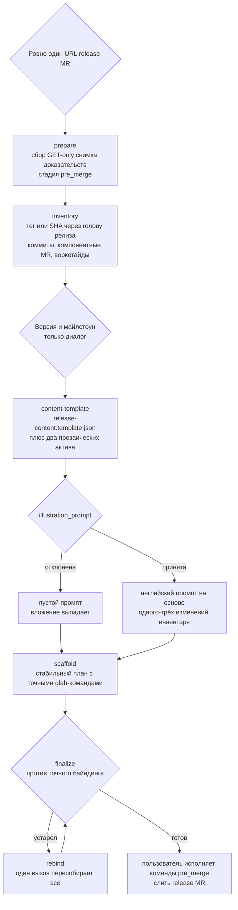
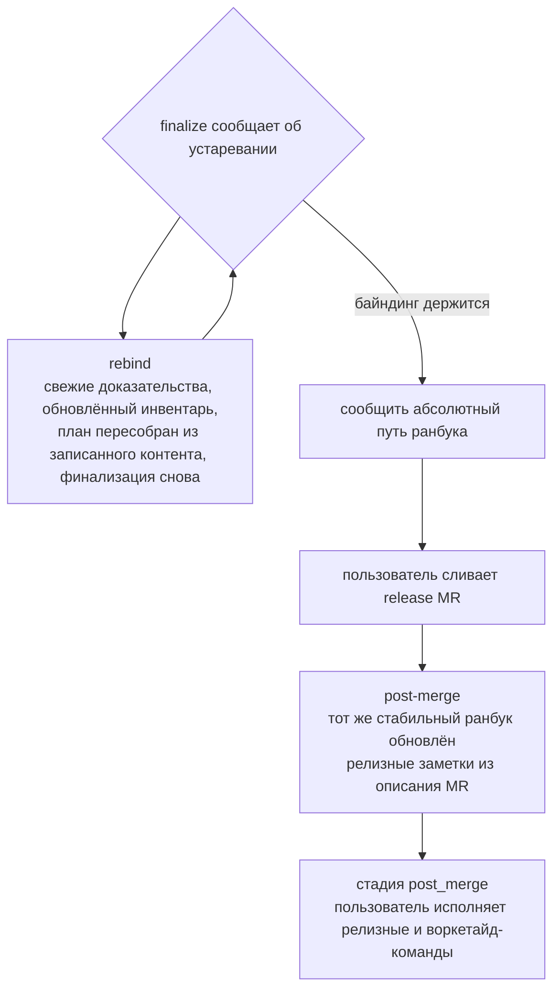

# Карта цепочки подготовки релиза

[English](../../reference/release-prepare.md)

Этот справочник отображает цепочку `release-prepare`: от одного release MR до
стабильного ранбука и post-merge обновления. Операционную доктрину владеют
тексты скилла в `skills/release-prepare/`; здесь — навигационный вид. Каждая
поверхность хелперов печатает свой полный контракт — словари полей, допустимые
значения и следующие команды — в собственном ответе, и напечатанный ответ —
единственный источник формата. Хелперы остаются read-only для GitLab: они
собирают доказательства и пишут локальные артефакты, но никогда не исполняют
команду публикации; пользователь запускает каждую команду вручную.

## Карта release-цепочки

Одна цепочка связывает всё: доказательства, инвентарь, контент, план,
финализацию и post-merge обновление. Устаревший план никогда не возвращает
цепочку к началу вручную.

**Диаграмма 1. Цепочка от принятого release MR до post-merge ранбука.**

Каждый шаг ниже называет команду, машинную часть и то, что агент пишет до
запуска следующего шага.

| Шаг | Команда | Машинная часть | Пишет агент |
| - | - | - | - |
| Собрать доказательства | `prepare_release.py prepare --url <release-mr-url>` | один принятый URL становится снимком доказательств | подтвердить точный release MR и чекаут |
| Построить инвентарь | `prepare_release.py inventory --evidence <evidence> --repo-root <checkout>` | полная пагинация коммитов, компонентных MR, апрувов и воркетайдов; явная граница `--previous-ref <tag-or-sha>` | проверить каждый элемент; сохранить точную границу |
| Решить версию и майлстоун | диалог | хелпер-команды нет | обоснование SemVer по наблюдаемым изменениям; выбор майлстоуна |
| Материализовать контент | `prepare_release.py content-template --bundle <evidence> --inventory <inventory>` | `release-content.template.json` с машинными предзаполнениями и два файла прозаических активов | заполнить смысловые поля; написать два прозаических актива |
| Собрать план | `prepare_release.py scaffold --bundle <evidence> --inventory <inventory> --content <content>` | `release-publication.json` с отложенными командами `pre_merge` | проверить напечатанный ранбук; передать команды пользователю |
| Финализировать | `prepare_release.py finalize --plan <plan> --expected-binding <binding>` | свежесть против точного байндинга | сообщить только абсолютный путь стабильного ранбука |
| Перепривязать при устаревании | `prepare_release.py rebind --plan <pointer>` | свежие доказательства, обновлённый инвентарь, пересобранный план, финализация одним вызовом | разобрать напечатанные изменившиеся отпечатки с пользователем |
| Post-merge обновление | `prepare_release.py post-merge --plan <plan> --expected-binding <binding> --content <ledger>` | тот же ранбук, переставленный на стадию `post_merge` | подтвердить слитый MR; пользователь исполняет релизные команды |

## Прозаические активы, humanize и иллюстрация

Описание и анонс — прозаические активы: рантайм материализует
`release-description.md` и `release-announcement.md`, а контент ссылается на
них через `description_file` и `announcement_file` — длинная проза никогда не
инлайнится в JSON-контент. Заголовок, описание и анонс пишутся на языке
последнего запроса пользователя, затем проходят обязательный проход
`humanize`; регистр ченджлога ограничивает каждый пункт
пользовательски-заметимым поведением.

Иллюстрация опциональна. Когда пользователь её отклоняет, `illustration_prompt`
остаётся пустой строкой: рантайм записывает пометку об отклонении, выбрасывает
вложение из команды анонса и отмечает секцию ранбука отклонённой — выдуманный
промпт artwork никогда не заполняет непустое поле. Когда пользователь
соглашается, промпт — английский, 16:9, заземлённый в одном-трёх конкретных
изменениях инвентаря.

## Устаревание, rebind и post-merge обновление

Финализация перепроверяет точный байндинг: изменившиеся база, старт или
голова SHA, состояние MR или слияния, майлстоун, инвентарь, апрувы, решения
по элементам или пейлоад делают план устаревшим. Ответ устаревшей финализации
печатает точную одношаговую команду rebind; ручной повторный проход по
цепочке никогда не является ответом.

**Диаграмма 2. Цикл устаревания и post-merge обновление того же ранбука.**

Post-merge хелпер проверяет точный слитый MR и коммит, отвергает
существующий релиз или тег с тем же именем в другом месте, копирует описание
MR в заметки GitLab Release байт в байт и добавляет одну точную ручную
`glab`-команду релиза плюс по одной команде на каждое одобренное действие над
воркетайдом. Изменившийся инвентарь передаёт одобренный реестр контента через
`--content`; записи «без действия» и их обоснования остаются видимыми.

## Граница публикации

Каждый хелпер и этот скилл остаются read-only для GitLab. Пользователь
исполняет каждую подготовленную команду не более одного раза, разбирает
ответ — GraphQL API отвечает HTTP 200 даже при неудаче — и никогда не считает
отображённую команду или локальный файл доказательством исполнения.
Перегенерированные командные блоки несут явные маркеры статуса исполнения, и
действие со статусом «выполнено, но не подтверждено» остаётся видимым, пока
свежие доказательства GitLab не подтвердят целевое состояние.
